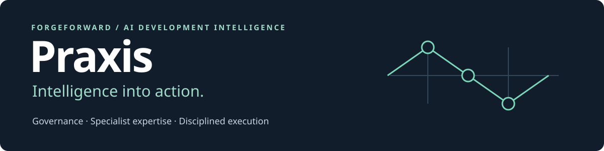
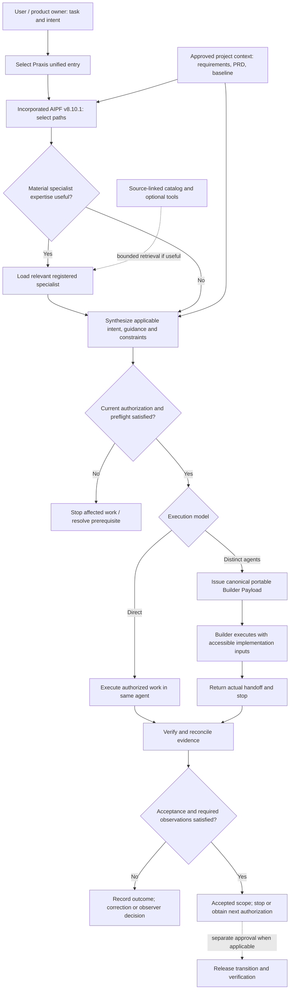

<p align="center">
  
</p>

<p align="center">
  <strong>Praxis</strong> helps AI agents turn project requirements into work you can verify.
</p>

<p align="center">
  
  
  
  
  
</p>

---

## Why Praxis exists

Getting an AI to write code is rarely the hardest part of building software with one. Keeping the work aligned with what you actually asked for is harder. An agent can fix a bug, change something unrelated, run a few tests and tell you everything works. Unless you know exactly what changed and what those tests covered, that last claim isn't particularly useful.

Praxis is ForgeForward's approach to that problem. It combines the [**AI Prompt-First Development Framework (AIPF) v8.10.1**](https://stevenpillow.com/aipf), specialist guidance and a source-linked knowledge catalog in a single repository. Give an agent access to Praxis and your project, and it can work out which development rules apply, what expertise it needs and how to verify the result.

AIPF is a framework we developed to establish what an agent is authorized to do, how it should verify its work and when it must stop. If you haven't come across it before, start with the [AIPF introduction on my website](https://stevenpillow.com/aipf). The full v8.10.1 framework is included in Praxis, so you don't need a separate AIPF installation.

It isn't another AI model or a hosted service. You keep using your coding assistant. Praxis gives it a consistent way to work.

One agent can handle the entire task, or a Prompt Agent can prepare instructions for a separate Builder. Both approaches are supported. The second is particularly useful when the tool doing the implementation has less access to project context than the agent planning the work.

## What this looks like in practice

Suppose you're improving keyboard navigation in an existing dashboard. You want the controls to work properly, not a new color scheme or a redesigned application. Praxis uses the existing project requirements and AIPF to establish that boundary. The UI/UX specialist can then help with focus visibility, accessible control names and keyboard behavior without treating the task as an invitation to redesign the interface.

A database-only correction doesn't need that specialist. Neither does every small wording change. Loading more guidance isn't inherently useful; it needs to improve the work at hand.

That distinction matters. During development, we found that requests beginning with “make” or “update” could trigger new-theme recommendations even when the request was strictly about accessibility. We corrected the retrieval logic and added regression cases for both focused corrections and genuine new-design requests.

## Rules worth keeping

- **Access is not permission.** An agent that can edit a repository or deploy an application still needs authorization to do so.
- **Requirements are not an open-ended work order.** A PRD may describe an entire product. The current task defines what the agent may change now.
- **Specialist advice stays inside the approved scope.** A design reference doesn't override an established brand, required behavior or AIPF rule.
- **A reference is not a license.** Finding a font, photograph or icon in the catalog doesn't establish permission to redistribute it.
- **Tests prove what they test.** A passing suite cannot establish that a rendered interface is readable or that keyboard navigation works unless those behaviors were actually checked.
- **Finishing implementation is not permission to release.** Acceptance, publication and deployment are separate decisions where applicable.

## How Praxis works



AIPF comes first. The agent selects the applicable development paths, consults specialists when the task warrants it, and checks that the work is authorized and ready. If required governance is missing, the affected work stops. Missing optional specialist knowledge can have a documented fallback when the approved project context is sufficient.

The diagram is an overview; the incorporated AIPF Path Selector and issuance rules govern the actual decisions.

### One agent or two?

| | Direct execution | Separate Prompt Agent and Builder |
| --- | --- | --- |
| Loads Praxis and selects paths | Executing agent | Prompt Agent |
| Consults specialist guidance | Executing agent | Prompt Agent |
| Implements | Same agent | Builder, using the authorized payload and accessible target files |
| Verifies | Executing agent and any required observers | Builder checks, Prompt Agent reconciliation and any required observers |
| Stops | At the authorized boundary | Builder returns its handoff and stops; Prompt Agent reconciles before further work |

The Builder doesn't need its own copy of Praxis, AIPF, the catalog or the PRD. It can have access to those resources, but the workflow must not depend on it. The Prompt Agent needs to carry the relevant requirements, decisions, constraints and acceptance checks into the Builder Payload. The Builder still needs access to the application and the tools required to change it.

There is a tradeoff here. A short prompt is attractive, but leaving out a requirement can cost more than the tokens saved. We prioritize correctness and operational completeness, then remove repetition that doesn't help execution. A direct agent doesn't need to manufacture a handoff to itself.

## Getting started

### 1. Get Praxis

If you haven't cloned Praxis yet, run these commands to get a local copy and check out v1.0.0:

```bash
git clone https://github.com/S-Pillow/praxis.git
cd praxis
git checkout v1.0.0
```

Already have a local checkout? Run `git checkout v1.0.0` from its root (fetch the tags first with `git fetch --tags` if needed). Pin the release you intend to use rather than assuming the latest branch is the reviewed version.

You don't need an API key, global plugin installation or a running Praxis service. Python 3 is required for the executable catalog tools and tests; reading the framework and skills doesn't require it. CI uses Python 3.12.

### 2. Tell your agent what to load

Make the Praxis checkout and your target project accessible to your agent. Ask it to load [`skills/praxis/SKILL.md`](skills/praxis/SKILL.md) from the pinned Praxis root. Then give it your actual task.

For direct execution:

> Use Praxis from my pinned checkout to improve the accessibility and readability of the existing dashboard. Preserve the approved brand and functionality. Inspect the current source and establish the correction scope before changing files.

For a separate Builder:

> Use Praxis to prepare an implementation-ready Builder Payload for the approved incident management dashboard. Consult relevant specialist guidance. Make the payload usable without access to the governing documents, and assign visual verification to an observer who can actually inspect the interface.

These are starting requests, not blanket authorizations. The agent must establish the current scope and prerequisites for the actual project.

### 3. Use your usual coding environment

| Environment | How to use Praxis |
| --- | --- |
| Repository-aware agent | Use repository-local discovery where supported, or explicitly load the entry file. |
| Cursor | Repository-based activation and separate Task-agent execution have been exercised. Native skill-picker discovery has not been established. |
| Codex and other compatible agents | Use the repository adapter or explicit entry file. Native Codex discovery has not been independently verified. |
| External Builder or hosted coding tool | Transfer the authorized payload and provide access to the implementation inputs. Confirm its tools and observation capabilities first. |
| Chat without file or command access | Supply accessible governing inputs. Do not claim retrieval or execution that the host cannot perform. Missing required governance blocks governed work. |

[`AGENTS.md`](AGENTS.md) and the [discovery adapter](.agents/skills/praxis/SKILL.md) help compatible hosts find Praxis. Opening a different application repository doesn't install Praxis globally. If discovery fails, use the explicit entry file. See [PRAXIS.md](PRAXIS.md) for the full workflow.

## UI/UX specialist (v0.3)

UI/UX is the first registered specialist. It is consulted for material interface work under AIPF Chapter 14 and can also be used independently.

| Mode | Use it when |
| --- | --- |
| `build` | Creating or materially improving an interface within approved requirements. |
| `critique` | Reviewing hierarchy, readability, usability and visual coherence. |
| `audit` | Checking technical interface requirements, including accessibility and observable behavior. |

The specialist is not a theme generator that needs to run on every task. It uses one initial recommendation lookup when useful, followed by at most one justified targeted search within the same lookup scope. The agent must decide which references fit, reject those that don't, and preserve the approved design identity.

We learned why the verification step matters during the incident-dashboard exercise. The first dashboard looked reasonable in screenshots, but orange and amber priority text fell below the required 4.5:1 contrast ratio. The next independent exercise measured candidate color pairs before issuing the payload, rejected inadequate combinations and used verified badge colors instead. Looking accessible and meeting a measured requirement are different things.

The specialist now requires applicable prescribed contrast pairs to be checked before issuance. That doesn't replace inspection of the finished interface.

<details>
<summary><strong>Optional command-line tools</strong></summary>

Run these from the Praxis root. They are separate examples, not three mandatory steps for every task.

```bash
python scripts/recommend_design.py "Build a financial dashboard with readable tables" --mode build --platform web
python scripts/search_catalog.py "keyboard focus" --limit 3
python scripts/check_contrast.py "#7F1D1D" "#FEE2E2" --minimum 4.5
```

The recommender returns three results by default and accepts a limit of 1–5. Choose the actual mode and platform for your task. The optional `praxis_context.py` helper takes an already-selected task and framework chapters; it is not a natural-language classifier or a replacement for AIPF routing. Use its successful recommendation lookup or the direct command, not both for the same initial lookup.

The contrast calculator accepts opaque six-digit sRGB hex colors. It checks a color pair, not an entire interface. On non-UTF-8 hosts, use `python -X utf8` where needed.

See the [specialist instructions](skills/aipf-ui-ux/SKILL.md), [catalog search contract](catalog/SEARCH.md) and [integrated workflow](PRAXIS.md).

</details>

## Design knowledge and its sources

The catalog contains **5,500 source-linked design records** and a separate starter file with examples. It includes metadata, guidelines, style references and design tokens. No third-party font files, photographs or screenshots are bundled. Some descriptions and tokens, including an embedded SVG texture, come from upstream sources and remain subject to their applicable terms.

| Source | Reference |
| --- | --- |
| Hallmark | [Nutlope/hallmark](https://github.com/Nutlope/hallmark) |
| UI UX Pro Max | [nextlevelbuilder/ui-ux-pro-max-skill](https://github.com/nextlevelbuilder/ui-ux-pro-max-skill) |
| Open Design Agent Kit | [feimacode/open-design-agent-kit](https://github.com/feimacode/open-design-agent-kit) |
| Impeccable | [pbakaus/impeccable](https://github.com/pbakaus/impeccable) |
| MengTo Skills | [MengTo/Skills](https://github.com/MengTo/Skills) |

The [field map](catalog/mappings/source-field-map.md) explains how source records were normalized. The [license register](research/licensing/source-license-register.md) records upstream terms and item-level redistribution gates. A repository license doesn't necessarily cover every photograph, font, icon or brand asset referenced inside it.

### Browse the catalog yourself

The optional Design Index is a local browser for the same catalog. From the Praxis root, run:

```bash
python ui/catalog-explorer/server.py --port 8765
```

Open `http://127.0.0.1:8765/` on the same computer. Search and filter records, inspect their sources and tokens, save references in browser-local storage, or copy a brief for your agent. Press Ctrl+C in the server terminal when finished.

The server uses Python's standard library and binds to loopback. No database, account or external runtime is required. It doesn't call an AI or change your application. You don't need to run it for agent-side retrieval.

See the [Design Index guide](ui/catalog-explorer/README.md).

## What we've actually verified

The accepted QUALITY-01 implementation passed 134 regression tests on Linux and 134 on Windows. All 17 frozen retrieval benchmark cases reproduced their original outputs after the inherited defects were corrected. Independent Cursor exercises also demonstrated a Prompt Agent preparing a payload, a separate Builder implementing it without depending on governing documents, and the Prompt Agent reconciling the result.

The earlier test suite missed real defects. Typing `/` in the design-task textarea moved focus to search; clearing search reset the category and left Saved; and Saved search didn't match the same references as Explore. Those failures now have targeted regression coverage. Passing the old tests wasn't enough.

| Evidence | Result |
| --- | --- |
| QUALITY-01 regression | 134/134 on Linux and Windows |
| Frozen retrieval benchmarks | 17/17 original outputs reproduced |
| Quality findings | 13 addressed, including contrast, retrieval limits and framework identity |
| Independent agent workflow | Demonstrated |
| Operator acceptance | VALIDATION-05 accepted with notes, November 25, 2026 |

There are limits to that evidence. Native Codex discovery and actual GitHub workflow dispatch remain unverified. Catalog browser regression used isolated Chromium documents with synthetic API responses, not a complete Windows HTTP integration test. The disposable dashboard also revealed two remaining opportunities: retaining keyboard focus after incident selection and using a more appropriate accessible selection state.

These results belong to the tested source and environment. They don't guarantee future agent compliance, establish blanket WCAG conformance or prove that Praxis is better than every other development approach.

To run the regression suite yourself, use:

```bash
python -m unittest discover -s tests -v
```

The [testing guide](docs/TESTING.md) covers optional browser checks with available Playwright/Chromium and permanent scenario regression. Keep original evidence intact, and distinguish direct observations from reported results and inferences.

## Repository architecture

| Path | Purpose |
| --- | --- |
| `PRAXIS.md` / `AGENTS.md` | Integrated usage and repository agent guidance |
| `framework/` | Complete unchanged AIPF v8.10.1 projection and identity manifest |
| `skills/praxis/` | Unified entry and payload synthesis guidance |
| `skills/aipf-ui-ux/` | Registered UI/UX specialist |
| `skills/specialists.json` | Specialist registry |
| `.agents/skills/` | Repository-scoped discovery adapters |
| `catalog/` | Source-linked records, schema, field mapping and search contract |
| `scripts/` | Optional local lookup, verification and maintenance tools |
| `ui/catalog-explorer/` | Local Design Index |
| `tests/` | Executable regressions and scenario fixtures |
| `docs/` | Approved baseline, architecture, decisions and verification guidance |
| `research/` | Historical evaluations, source provenance and licensing research |

## Deep-dive documentation

| Domain | Start here |
| --- | --- |
| Product requirements | [PRD](docs/PRD.md) |
| Logical architecture | [Architecture](docs/ARCHITECTURE.md) |
| Historical approved baseline | [Development baseline](docs/DEVELOPMENT-BASELINE.md) |
| Usage | [Praxis workflow](PRAXIS.md) · [Unified entry](skills/praxis/SKILL.md) |
| Incorporated framework | [Framework identity](framework/README.md) |
| Specialist | [Skills overview](skills/README.md) · [Registry](skills/specialists.json) |
| Catalog | [Search contract](catalog/SEARCH.md) · [Design Index](ui/catalog-explorer/README.md) |
| Validation | [Testing strategy](docs/TESTING.md) · [Permanent scenario regression](docs/decisions/PRAXIS-DEC-001-scenario-regression.md) |
| Builder portability | [Context independence](docs/decisions/PRAXIS-DEC-002-builder-context-independence.md) |
| Prompt quality | [Quality-first decision](docs/decisions/PRAXIS-DEC-003-quality-first-prompts.md) |
| Version history | [Changelog](CHANGELOG.md) |
| Release evidence | [v1.0.0 release record](docs/releases/1.0.0.md) |
| Repository participation | [Contributing](CONTRIBUTING.md) · [Security reporting](SECURITY.md) · [Third-party notices](THIRD_PARTY_NOTICES.md) |

## Where Praxis goes next

UI/UX is the only registered specialist in this first release. More specialists and a packaged plugin are possible future additions, not features you can use today. The standalone AIPF framework remains separate and unchanged; Praxis incorporates v8.10.1 without changing its version or authority.

## License and provenance

I’ve chosen [Apache-2.0](LICENSE) for the original Praxis code, documentation and the incorporated AIPF framework. You can use, modify and redistribute those materials, including in commercial projects, under the terms of that license. Third-party materials retain their original terms. See [NOTICE](NOTICE) for attribution. Consult the [license register](research/licensing/source-license-register.md) and [third-party notices](THIRD_PARTY_NOTICES.md) before redistributing material. Knowing where something came from is not the same as having permission to copy it.
