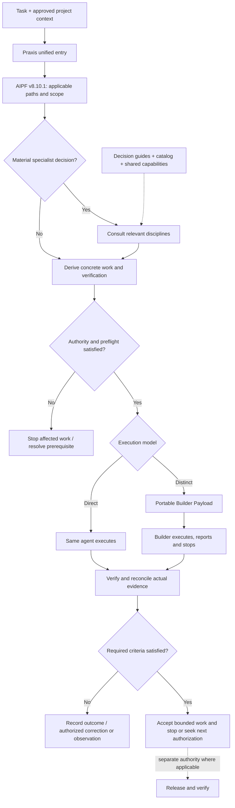

<p align="center">
  
</p>

<p align="center">
  <strong>A unified AI-assisted development system: from requirements and engineering decisions to implementation and verified results.</strong>
</p>

<p align="center">
  <a href="https://github.com/S-Pillow/praxis/releases"></a>
  <a href="framework/README.md"></a>
  <a href="skills/README.md"></a>
  <a href="docs/releases/1.3.0.md"></a>
  <a href="LICENSE"></a>
</p>

<p align="center">
  <a href="#quick-start">Quick start</a> ·
  <a href="#specialists">Specialists</a> ·
  <a href="#how-praxis-works">How it works</a> ·
  <a href="#knowledge-and-capabilities">Knowledge</a> ·
  <a href="#verification-and-evidence">Evidence</a> ·
  <a href="#documentation">Documentation</a>
</p>

---

## What is Praxis?

AI coding assistants can generate code, but generating code is only one part of engineering a dependable product. The harder questions are often what should be built, which approach fits, what must remain unchanged, whether the result actually works, and what evidence is sufficient to accept it.

**Praxis combines structured development governance, task-specific engineering expertise, source-linked knowledge and disciplined verification in one repository.** It is ForgeForward's approach to helping the AI assistant you already use work through those questions, rather than treating every request as an isolated coding prompt.

Praxis is not a new model, IDE, hosted agent platform, or collection of mandatory autonomous agents. It is a repository-based system that a compatible assistant can read and apply to the project at hand. It supports planning, new development, existing-system changes, diagnosis and review. It does not require a Praxis API key, global installation or running service.

### What it brings together

| Layer | Contribution |
| --- | --- |
| **Governance** | The complete, unchanged [AI Prompt-First Development Framework (AIPF) v8.10.1](framework/README.md) establishes scope, authorization, applicable paths, verification and stop conditions. |
| **Specialist intelligence** | Four registered disciplines supply practical, conditional engineering judgment when their expertise can improve the current task. |
| **Knowledge** | Original decision guides, source-linked design references and independent technology/service capability records support informed choices. |
| **Execution** | Work directly with one agent, or have a Prompt Agent derive an operationally complete payload for a separate Builder. |
| **Evidence** | Distinguish source inspection, actual execution, independent observations and unresolved gaps; reconcile results before acceptance or release. |

AIPF remains independently maintained and can be used without Praxis. Praxis incorporates it unchanged, adds domain expertise, and integrates those contributions into a single workflow. It does not replace project requirements or introduce a competing authority.

Learn about the standalone framework at [stevenpillow.com/aipf](https://stevenpillow.com/aipf).

## Quick start

### 1. Obtain a pinned version

```bash
git clone https://github.com/S-Pillow/praxis.git
cd praxis
git checkout v1.3.0
```

Use the v1.3.0 tag once it is published, or select an existing published tag from the [release list](https://github.com/S-Pillow/praxis/releases). For an existing checkout, run `git fetch --tags` first. Pinning a reviewed release makes the framework, guidance and evidence reproducible; a moving branch is not the same thing as a released version.

### 2. Give your assistant access to Praxis and your project

Ask it to load [`skills/praxis/SKILL.md`](skills/praxis/SKILL.md) from the pinned repository root, then provide the actual task and applicable project requirements. The agent selects the appropriate AIPF paths and material specialist expertise; you do not need to select all four specialists or run retrieval commands yourself.

**Example direct request:**

> Use Praxis from my pinned checkout. Investigate why an older search response can overwrite a newer result. Preserve the existing interface and public behavior. Reproduce the failure, establish its cause, and propose a focused correction and regression checks within the authorized scope.

**Example separate Builder request:**

> Use Praxis to prepare a self-contained implementation-ready Builder Payload for the approved inventory dashboard. Consult relevant specialist expertise, preserve the approved architecture and access rules, define observable positive and negative tests, and identify any required browser or independent observations. Stop at the handoff.

These are starting requests, not blanket authorizations. The assistant must establish the actual scope, permissions, accessible inputs and prerequisites.

### 3. Use your existing coding environment

| Environment | Approach and limits |
| --- | --- |
| Repository-aware coding assistant | Make the repository readable and load the Praxis entry. Repository-local discovery is available where the host supports it. |
| Cursor | Repository-based activation and separate Task-agent execution have been exercised. Native skill-picker discovery has not been established. |
| Codex / other compatible assistants | Use the repository adapter or explicit entry file. Native Codex discovery has not been independently verified. |
| Separate Builder | Provide the authorized payload and accessible implementation inputs. Access to Praxis or the governing documents is optional, not a prerequisite. |
| Chat without file/command access | Provide accessible governing inputs; do not claim retrieval or tests that cannot be performed. Missing required governance blocks governed work. |

[`AGENTS.md`](AGENTS.md) and the [repository discovery adapter](.agents/skills/praxis/SKILL.md) help compatible hosts. Opening another repository does not install Praxis globally. Python is not required to read the framework and guides; the optional local tools and test suite use Python 3 (CI uses 3.12).

## Specialists

Praxis has **four registered specialists in the v1.3.0 source**. They are complementary disciplines, not four independent agents, mandatory phases, or additional approval authorities. A single task may need one, several, or none.

| Specialist | Version | Consultation modes | Main question |
| --- | --- | --- | --- |
| [UI/UX & Design Intelligence](skills/aipf-ui-ux/SKILL.md) | 0.3 | build · critique · audit | Is the experience appropriate, usable and coherent? |
| [Software Architecture & Engineering Design](skills/architecture/SKILL.md) | 0.1 | design · evolve · critique | Is the solution structured appropriately for its requirements? |
| [Security & Privacy](skills/security-privacy/SKILL.md) | 0.1 | design · harden · review | Are trust boundaries, resources and data protected? |
| [QA & Engineering Quality](skills/qa-engineering-quality/SKILL.md) | 0.1 | plan · diagnose · review | Does the solution behave correctly, and what establishes that? |

### UI/UX & Design Intelligence

Consult for material user-facing design, interface improvement, visual/usability critique and technical UI audit. Use existing brand and behavior constraints before selecting new references.

- Layout, hierarchy, typography, design systems, components and responsive states.
- Usability, keyboard/focus, contrast and accessible interaction.
- Source-linked recommendations and design tokens from the catalog; reject unsuitable references instead of copying them blindly.
- Verify applicable contrast pairs before issuing design instructions; inspect actual rendered behavior where required.

**Knowledge:** 5,500 source-linked catalog records. The specialist can also be used independently; a material UI request triggers the bounded read-only lookup when the catalog and runner are available.

[Skill](skills/aipf-ui-ux/SKILL.md) · [Search contract](catalog/SEARCH.md) · [Design Index](ui/catalog-explorer/README.md)

### Software Architecture & Engineering Design

Consult for material new-system design, existing-system evolution and structural critique. Select the simplest suitable approach rather than imposing a preferred framework or pattern.

- System boundaries, responsibilities, data models, interfaces and integration contracts.
- Technology/service selection, quality attributes, workload and maintainability tradeoffs.
- Preserve accepted behavior during evolution; compare retaining, extending, refactoring and replacing only where justified.
- Consider failure behavior, migration, recovery and verification implications before implementation.

**Knowledge:** 11 progressive guides, 33 original decision cards.

[Skill](skills/architecture/SKILL.md) · [Decision index](skills/architecture/INDEX.md) · [Sources](skills/architecture/SOURCES.md) · [Requirements](docs/PRD.md#8-architecture--engineering-design)

### Security & Privacy

Consult for material secure design, hardening and source assessment. Derive controls from actual assets, actors, threats, resources, data flows and purpose—not a universal checklist.

- Authentication, authorization, ownership, tenant boundaries and least privilege.
- Input handling, secrets, cryptography, supply-chain and agent/tool trust.
- Data minimization, collection, retention, deletion, logging and disclosure.
- Positive and negative control checks, source-bound findings, counterevidence and appropriate corrections.

**Knowledge:** Nine progressive guides, 36 original decision cards. Source review is not authority to probe live systems, install scanners, disclose data or accept risk.

[Skill](skills/security-privacy/SKILL.md) · [Decision index](skills/security-privacy/INDEX.md) · [Sources](skills/security-privacy/SOURCES.md) · [Requirements](docs/PRD.md#13-security-and-privacy-specialist)

### QA & Engineering Quality

Consult for material test strategy, diagnosis, regression and engineering-quality review. Verify meaningful behavior and the effectiveness of the tests themselves, not just whether a test command turns green.

- Risk and impact, independent oracles, boundary/property/state and contract testing.
- Browser and user-facing behavior, failure injection, retry, recovery, concurrency and flakiness.
- Causal diagnosis, comparable baseline/candidate checks, targeted mutation and regression.
- Data integrity, maintainability, AI/agent outcomes, tool constraints, evaluation validity and appropriate abstention.

**Knowledge:** Twelve progressive guide families, 37 original decision cards. Different valid agent execution paths are acceptable; an unauthorized action is not. Actual verification requires suitable tools, observers and authority. No mandatory runner or evaluation service.

[Skill](skills/qa-engineering-quality/SKILL.md) · [Decision index](skills/qa-engineering-quality/INDEX.md) · [Sources](skills/qa-engineering-quality/SOURCES.md) · [Requirements](docs/PRD.md#14-qa--engineering-quality-specialist)

### How the disciplines work together

Consider a shared dashboard that lets an owner update inventory and view aggregate activity. This illustrative scenario is not a claim that Praxis includes an inventory application.

| Discipline | Concrete contribution |
| --- | --- |
| Architecture | Choose suitable component, data and API boundaries; define update and retry semantics. |
| Security & Privacy | Establish who can modify which resource, what data is necessary and what must not be disclosed or logged. |
| UI/UX | Define clear form, keyboard/focus, loading, error and recovery states within the approved design. |
| QA | Verify allowed and denied updates, actual state changes, zero-value handling, duplicate retry prevention and observable user feedback. |

The agent synthesizes those decisions into one coherent strategy or authorized payload. AIPF controls authorization, evidence and acceptance throughout. A minor typo does not need this full consultation; a simple backend correction does not need UI/UX merely because the product has a UI.

## How Praxis works



This is an explanatory overview, not an alternative to the canonical AIPF Path Selector or issuance rules.

### Direct or separate-agent execution

| Responsibility | Direct execution | Separate Prompt Agent and Builder |
| --- | --- | --- |
| Load governance and select relevant expertise | Executing agent | Prompt Agent |
| Derive implementation and verification requirements | Executing agent | Prompt Agent creates canonical operational payload |
| Implement within scope | Same agent | Builder using accessible target files and tools |
| Verify and reconcile | Agent and required observers | Builder reports; Prompt Agent reconciles, with required observers |
| Stop | At authorization boundary | Builder returns handoff and stops; Prompt Agent controls subsequent work |

A distinct Builder does not need its own copy of Praxis, AIPF, the catalog or the PRD. Optional access grants no extra authority. The payload must carry actual requirements, relevant design decisions, constraints, expected outcomes, evidence and stop conditions; the Builder still needs the implementation inputs and tools required for the task.

Correctness and operational completeness come before token efficiency. Direct execution needs no artificial self-handoff.

### Principles that apply throughout

- Access is not permission; the current authorization defines what may change.
- A PRD is not an open-ended work order; preserve accepted behavior and protected scope.
- Consult expertise when it can improve a material decision, not just because a chapter or keyword matches.
- A reference is not a license; a candidate tool is not an approved dependency.
- Passing tests establish only what their assertions and observed environment support.
- Implementation, acceptance and publication remain distinct where required.

See [integrated workflow](PRAXIS.md), [Builder context independence](docs/decisions/PRAXIS-DEC-002-builder-context-independence.md) and [quality-first prompts](docs/decisions/PRAXIS-DEC-003-quality-first-prompts.md).

## Knowledge and capabilities

| Resource | Scope in the v1.3.0 source |
| --- | --- |
| Design catalog | 5,500 source-linked records, plus a separate starter file |
| Architecture, Security and QA decision knowledge | 32 progressive guide families and 106 original decision cards (11/33, 9/36 and 12/37 respectively) |
| Shared technology/service capability index | 30 discovery records, usable independently of a specialist |
| Cross-specialist research | 14 retained leads for future decisions, not approved implementations |

Guidance is progressively loaded from question-led indexes rather than sending the entire corpus to every agent. Decision cards describe context, alternatives (including no change), tradeoffs, counterexamples, verification and source limitations. Shared capability records describe candidates, not a required stack. Verify material version, rights, access, data flow, pricing, limits and exhaustion behavior at point of use; a free-tier pointer is not a cost guarantee.

[Shared capability index](knowledge/capabilities/INDEX.md) · [Qualification guidance](knowledge/capabilities/QUALIFICATION.md) · [Deferred research](research/CROSS-SPECIALIST-RESEARCH-REGISTER.md)

### Design catalog and local Design Index

The design catalog normalizes references from [Hallmark](https://github.com/Nutlope/hallmark), [UI UX Pro Max](https://github.com/nextlevelbuilder/ui-ux-pro-max-skill), [Open Design Agent Kit](https://github.com/feimacode/open-design-agent-kit), [Impeccable](https://github.com/pbakaus/impeccable) and [MengTo Skills](https://github.com/MengTo/Skills). It contains metadata, design guidance, style references and tokens. No third-party font files, photographs or screenshots are bundled; some upstream descriptions and tokens, including an embedded SVG texture, retain their original terms.

For manual browsing, run from the Praxis root:

```bash
python ui/catalog-explorer/server.py --port 8765
```

Visit `http://127.0.0.1:8765/` on the same computer. Search, filter, inspect source records, save references in browser-local storage or copy a brief. Stop the server with Ctrl+C.

The optional Design Index uses Python's standard library and binds to loopback. No account, AI connection, database or public deployment is needed. Local request logging remains a privacy consideration; avoid sensitive queries. The browser is not required for agent-side retrieval.

[Design Index guide](ui/catalog-explorer/README.md) · [Field map](catalog/mappings/source-field-map.md) · [Source/license register](research/licensing/source-license-register.md)

<details>
<summary><strong>Optional commands for technical users and agents</strong></summary>

Run from a pinned Praxis checkout. These are independent examples, not mandatory steps:

```bash
python scripts/recommend_design.py "Build a financial dashboard with readable tables" --mode build --platform web
python scripts/search_catalog.py "keyboard focus" --limit 3
python scripts/check_contrast.py "#7F1D1D" "#FEE2E2" --minimum 4.5
python scripts/praxis_context.py --task architecture-design --chapter 11
python scripts/praxis_context.py --task security-design --chapter 12
python scripts/praxis_context.py --task qa-diagnose --chapter 12
```

Use the actual selected path and task. The helper resolves explicit task IDs and chapter eligibility; it neither classifies free text nor proves the agent read or applied the specialist. Architecture, Security and QA have no required lookup subprocess. UI/UX uses one initial lookup when applicable and at most one justified targeted search within the same scope. The recommender defaults to three results, accepts limits 1–5, and returns candidates rather than approved designs. A contrast check evaluates one opaque sRGB color pair, not an entire interface. Use `python -X utf8` on non-UTF-8 hosts where needed.

</details>

## Verification and evidence

The project retains standing regressions, source-bound observations, disposable direct exercises, separate Builder handoffs and independent reviewer evidence. These support different claims; test counts are not interchangeable.

| Milestone | Representative integrated regression | Evidence |
| --- | --- | --- |
| Praxis v1.0.0 / UI/UX | 137/137 final pre-publication; historical QUALITY-01 134/134 per OS | [v1.0.0 record](docs/releases/1.0.0.md) |
| Praxis v1.1.0 / Architecture | 155/155 Linux and native Windows | [v1.1.0 record](docs/releases/1.1.0.md) |
| Praxis v1.2.0 / Security | 163/163 Linux and native Windows | [v1.2.0 record](docs/releases/1.2.0.md) |
| Praxis v1.3.0 / QA | 173/173 Linux and native Windows at accepted B4 commit `b36e6f5` | [B4 CI](https://github.com/S-Pillow/praxis/actions/runs/45847126856) · [v1.3.0 record](docs/releases/1.3.0.md) |

### Why tests alone are not enough

- **UI/UX:** Earlier browser and accessibility exercises exposed focus, filtering and contrast defects that the old checks missed. Targeted regression coverage was added; 17 frozen retrieval cases reproduced their original outputs.
- **Architecture:** A separate synthetic Builder exercise reached 25/25 after targeted correction, distinct from the standing Praxis regression.
- **Security:** An independent Builder's original 15 passing tests missed four reviewer findings. The corrected synthetic implementation reproduced 22/22 tests, plus 14/14 additional reviewer checks. This is not a live security audit.
- **QA:** The distinct inventory Builder reported 19/19 on Windows, reproduced 19/19 on Linux, and passed nine additional reviewer tests. A deliberately defective copy survived the original 19 tests but failed a reviewer receipt-integrity assertion. The submitted original was correct. The QA integration itself initially failed the inherited capability schema test (172/173 on each OS); the corrected B4 candidate passed all 173 without weakening assertions.

The accepted QA candidate's 42 requirements and 18 acceptance criteria were reconciled in B4. Eight external behavioral requests used one shared agent context and an unknown host model version. They support bounded consultation and composition observations, not eight independent trials or universal agent reliability. Private raw evidence is retained outside the public repository; release records retain provenance, identities and limitations.

### Run the standing suite

```bash
python -m unittest discover -s tests -v
```

The test suite verifies repository mechanisms and relevant standing behavior. Actual browser behavior, provider integrations, semantic agent decisions and independent execution require appropriate separate observations. Historical catalog-browser checks used isolated Chromium documents with synthetic API responses, not a full Windows browser/HTTP integration. Native host discovery and the manual enrichment workflow dispatch remain unverified. Residual disposable-dashboard focus/selection observations are recorded in earlier release evidence.

No claim is made of universal security, WCAG conformance, guaranteed cost, all-host activation or comparative superiority over AIPF alone. The [testing strategy](docs/TESTING.md) and [release records](docs/releases/1.3.0.md) distinguish scope, environment, observer and limitations. Published version identity comes from the [GitHub releases](https://github.com/S-Pillow/praxis/releases), not a badge or source version label.

## Repository layout

| Path | Purpose |
| --- | --- |
| [`PRAXIS.md`](PRAXIS.md), [`AGENTS.md`](AGENTS.md) | Integrated usage and repository agent guidance |
| [`framework/`](framework/README.md) | Complete AIPF v8.10.1 projection and identity manifest |
| [`skills/`](skills/README.md) | Unified entry, specialist guidance, registry and progressive references |
| [`knowledge/capabilities/`](knowledge/capabilities/INDEX.md) | Independent capability discovery and qualification |
| [`catalog/`](catalog/SEARCH.md) | Design records, schema, field mapping and search contract |
| `scripts/` | Optional local lookup, verification and maintenance tools |
| [`ui/catalog-explorer/`](ui/catalog-explorer/README.md) | Local Design Index |
| `tests/` | Standing regression and scenario fixtures |
| [`docs/`](docs/PRD.md) | Canonical requirements, architecture, decisions and release evidence |
| `research/` | Source provenance, licensing, historical evaluations and deferred investigations |

## Documentation

| I want to… | Read |
| --- | --- |
| Understand the whole product | [Canonical product PRD v1.4](docs/PRD.md), [logical architecture](docs/ARCHITECTURE.md) |
| Use Praxis with my agent | [Integrated workflow](PRAXIS.md), [entry skill](skills/praxis/SKILL.md), [specialist registry](skills/specialists.json) |
| Understand the underlying framework | [AIPF identity and projection](framework/README.md), [AIPF introduction](https://stevenpillow.com/aipf) |
| Design a portable Builder handoff | [Context independence](docs/decisions/PRAXIS-DEC-002-builder-context-independence.md), [payload synthesis](skills/praxis/references/builder-payload.md) |
| Verify work and evidence | [Testing strategy](docs/TESTING.md), [scenario regression decision](docs/decisions/PRAXIS-DEC-001-scenario-regression.md) |
| Review release history | [Changelog](CHANGELOG.md), [v1.3.0](docs/releases/1.3.0.md), [v1.2.0](docs/releases/1.2.0.md), [v1.1.0](docs/releases/1.1.0.md), [v1.0.0](docs/releases/1.0.0.md) |
| Understand decisions and development history | [Development baseline](docs/DEVELOPMENT-BASELINE.md), [specialist expansion decision](docs/decisions/PRAXIS-DEC-004-specialist-expansion.md) |
| Contribute or report a security issue | [Contributing](CONTRIBUTING.md), [Security reporting](SECURITY.md) |

## Roadmap

The long-term direction is a multidisciplinary engineering capability available to the assistant you already use. The current source includes four of the five planned specialist disciplines.

| Discipline or initiative | State |
| --- | --- |
| UI/UX & Design Intelligence v0.3 | Available since Praxis v1.0.0 |
| Software Architecture & Engineering Design v0.1 | Released in v1.1.0 |
| Security & Privacy v0.1 | Released in v1.2.0 |
| QA & Engineering Quality v0.1 | Qualified and owner accepted for v1.3.0 |
| DevOps & Reliability | Future: deployment, infrastructure, observability, recovery and operational resilience; not implemented |
| Review Parity | Deferred cross-cutting assurance research, not a fifth domain specialist or implemented approval runtime |
| Packaged plugin | Possible future distribution option, not a required installation |

The [product roadmap](docs/PRD.md#6-specialist-expansion-roadmap) establishes direction, not delivery commitments. Future requirements, implementation and publication require separate decisions. Research leads are retained in the [cross-specialist register](research/CROSS-SPECIALIST-RESEARCH-REGISTER.md). Neither a larger catalog nor more process is an objective in itself.

## License and provenance

Original Praxis code, documentation and incorporated AIPF materials are licensed under [Apache-2.0](LICENSE), including commercial use, modification and redistribution subject to its terms. Third-party materials retain their own terms; references, tokens and source metadata do not grant blanket rights to photographs, fonts, icons, code or brand assets.

See [NOTICE](NOTICE), [third-party notices](THIRD_PARTY_NOTICES.md) and the [source/license register](research/licensing/source-license-register.md) for attribution, item-level restrictions and provenance. The incorporated AIPF framework remains unchanged and independently maintained.

---

**Praxis — Intelligence into action.** Govern the work, apply the expertise that matters, and establish what the evidence actually supports.
