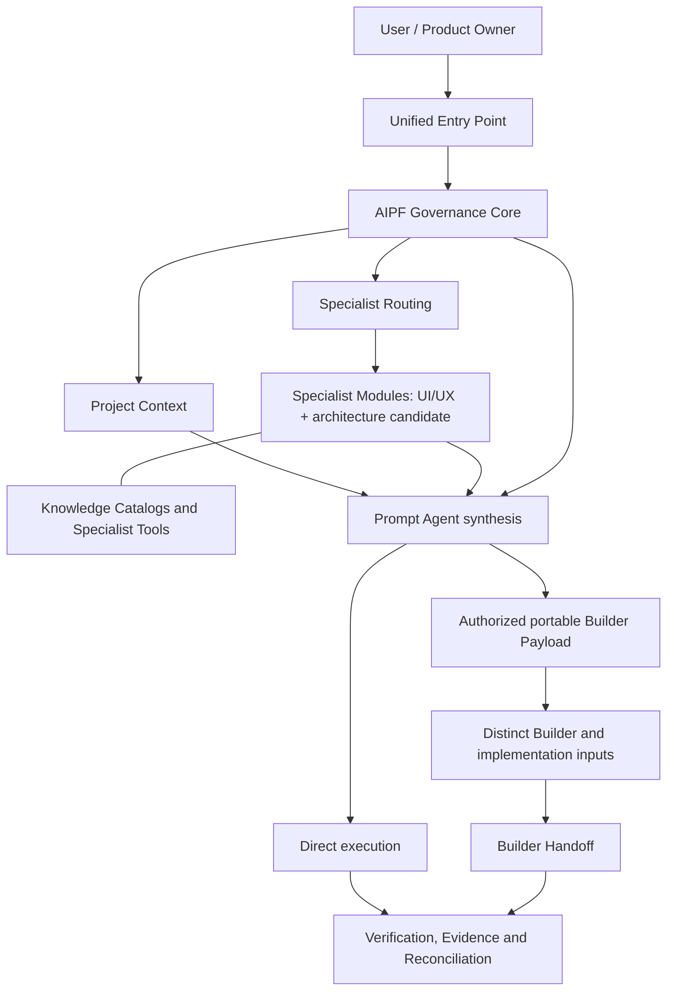

# Praxis — Architecture

Version: 0.1 | Status: Owner approved | Approval: 2026-11-24

## 1. Logical architecture



These are logical capabilities, not separate servers or mandatory running services. UI/UX remains the only registered specialist in v1.0.0. The subsequent [specialist roadmap](PRD.md#6-specialist-expansion-roadmap) prioritizes Software Architecture & Engineering Design next; the other specialists and cross-cutting assurance are future directions, not current deliverables.

## 2. Responsibilities and boundaries

- **Unified entry:** context and capability discovery, one entry point for the system.
- **Governance core:** AIPF path selection, scope, authorization, planning, verification and acceptance. Praxis incorporates the framework and may adapt its incorporated guidance when integration genuinely requires it, without compromising its purpose. The separate AIPF product is not modified by this work.
- **Project context:** PRD, architecture, decisions and baseline. Approved project requirements remain authoritative for what to build; project context does not itself grant execution authority.
- **Specialist routing:** consult relevant expertise following the AIPF path selection. Chapter 14 is the first integration point for material UI/UX work. Avoid consultation for unrelated or immaterial tasks.
- **Specialist intelligence:** practical domain expertise, subordinate to governing constraints and approved requirements. No independent authorization or expansion of scope.
- **Knowledge layer:** catalogs, patterns, references and retrieval tools. Evaluate retrieved material; reject unsuitable or conflicting recommendations and respect source provenance and licensing.
- **Execution layer:** use the agent's available capabilities; no mandatory orchestration service or multi-agent workflow. Support direct execution and distinct Prompt Agent/Builder execution.
- **Verification layer:** validate against requirements and acceptance criteria, preserve evidence, reconcile results and obtain required owner acceptance.

## 3. Operational workflow

1. Establish project intent, requirements, constraints and PRD as applicable.
2. Apply AIPF, select development paths and establish authorized scope.
3. Activate relevant specialists when material work requires their expertise.
4. Retrieve knowledge when useful and reject unsuitable recommendations.
5. Synthesize requirements, constraints and expertise into an actionable approach.
6. Implement directly, or produce an operational Builder Payload when using a separate Builder Agent.
7. Verify, preserve evidence and reconcile; obtain necessary owner acceptance.

The user need not separately invoke AIPF, the UI/UX specialist or retrieval scripts. In a separate-agent workflow the Prompt Agent controls scope and synthesizes the payload; the Builder executes authorized scope. A Builder Payload must be operationally complete and must not presume inaccessible context. The Prompt Agent holds Praxis, framework, specialist and project requirements context and derives the current T1. A distinct Builder normally receives only the authorized payload and accessible implementation inputs. Access to Praxis, AIPF, specialists, catalogs or PRD is permitted but optional, never required, and confers no additional authority. Payloads contain the required governing and design values, not internal derivation metadata; use verified accessible implementation baselines only as Chapter 21 permits. Direct execution does not require an artificial handoff. See [payload synthesis guidance](../skills/praxis/references/builder-payload.md).

## 4. Specialist integration contract

| Element | Purpose |
|---|---|
| Identity and version | Identify specialist and revision |
| Domain | Define expertise |
| Activation criteria | Determine relevant consultation |
| Framework integration | Identify applicable AIPF paths |
| Guidance | Domain-specific procedures |
| Knowledge sources | Catalogs and references |
| Tools | Available executable capabilities |
| Authority boundaries | Prevent unauthorized actions |
| Output expectations | Useful guidance and evidence |
| Fallback behavior | Handle unavailable capabilities |

Future specialists should primarily be added by implementing and registering them. Governing integration may evolve when necessary. Released v1.0.0 registers UI/UX only; the v1.1.0 development checkout adds architecture v0.1, qualified locally at B4; [pre-release validation remains pending](releases/1.1.0-pre-release.md). No placeholder specialists are required. Missing specialist capabilities must be reported transparently, with a suitable bounded fallback where feasible. Missing required governance cannot be silently bypassed.

For future integration, specialize in domain knowledge and practical engineering judgment rather than adding parallel governance. The Prompt Agent (or direct executing agent) selects and synthesizes relevant advice into concrete decisions, constraints, implementation guidance and verification implications. No mandatory specialist access, additional agent, retrieval engine or catalog is presumed for the Builder. Existing architecture and appropriate implementation discretion remain protected.

Potential Review Parity-derived assurance belongs in the cross-cutting verification/evidence capability rather than an independent domain specialist or new approval authority. Its integration is deferred and subject to separate qualification. These are forward-looking design principles under [DEC-004](decisions/PRAXIS-DEC-004-specialist-expansion.md), not implemented architecture.

### Implemented v1.1.0 candidate integration

Architecture design/evolve/critique consults original progressive guides in `skills/architecture/` and shared source-linked capability records in `knowledge/capabilities/`. The latter is independent of a particular specialist; stable guidance and volatile provider facts have distinct maintenance expectations. The candidate registry reader accepts a multi-path applicability field (`chapters_any: [11,12]` for architecture), retains legacy singular `chapter`, and supports omitted retrieval scripts without executing a process. Existing UI tasks, lookup protocol and output semantics are preserved. AIPF retains canonical routing, and agent-selected task materiality—not chapter presence alone—controls specialist activation. No provider client, external API, or new orchestration runtime is introduced. See the [build plan](ARCHITECTURE-SPECIALIST-BUILD-PLAN.md) and [PRD](PRD.md).

## 5. Proposed repository layout

```text
praxis/
  README.md       Product overview and usage
  AGENTS.md       Agent discovery and instructions
  PRAXIS.md       Unified system entry and integration
  framework/      Incorporated AIPF framework
  skills/         Praxis and specialist skill modules
  catalog/        Curated specialist knowledge
  scripts/        Retrieval and supporting tools
  .agents/        Agent-specific discovery adapters
  tests/          Regression and integration tests
  docs/           Product PRD and architecture
  research/       Research and historical evidence
  CHANGELOG.md    Product evolution
```

Retain working repository structure where practical. Do not move components merely for cosmetic restructuring. No runtime orchestration service, mandatory external APIs or additional specialists in initial scope.

## 6. Verification

Verify standalone framework loading, path-dependent activation, unrelated/minor task non-activation, single and distinct agent workflows (including a Builder without governing-context access and a Builder with optional access), portable payload completeness and protected scope, specialist unavailability, unchanged retrieval behavior and regression coverage. Distinguish static integration tests from observed real-world agent discovery and activation; the latter requires independent validation. The release criteria are maintained in [PRD.md](PRD.md).
